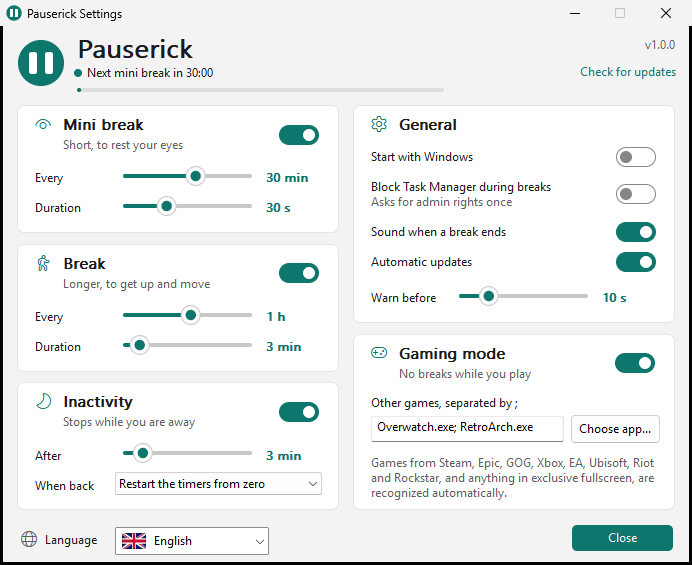

# Pauserick

A tiny, strict break reminder for Windows 10/11, in the spirit of Stretchly and Workrave.
It's plain Win32/C with no runtime or framework, and the executable is about 220 KB.
Everything runs on your PC: the only network access is an optional daily update check.



## Download

Get `Pauserick.exe` from the [latest release](https://github.com/Maverickxxz/pauserick/releases/latest).
There is no installer: it is a single exe.

The exe is not code-signed with a paid certificate, so the first time Windows SmartScreen may say
"Windows protected your PC": choose **More info > Run anyway**. Every release is built by GitHub Actions
from the code in this repository (see [Build](#build)); updates are verified with the maintainer's own signature (see [Updates](#updates)).

## Install

1. Copy `Pauserick.exe` to a permanent folder, for example `%LOCALAPPDATA%\Programs\Pauserick\`.
   Autostart points at this path, so choose the folder before enabling it.
2. Run it. Settings open on the first run, and the app lives in the tray after that.
   Every change takes effect and is saved immediately; there is no Save button.
3. Optional: turn on **Block Task Manager during breaks**. It is off by default.
   Windows asks once for administrator rights. Pauserick then copies itself to `C:\Program Files\Pauserick\`,
   a folder only administrators can change, and restarts from there, elevated, with Settings reopened.
   From then on it always runs elevated with no further prompts, whether you launch it by hand or it starts with Windows.

Left-click the tray icon to open Settings. Right-click it for: take a mini break now, take a break now, Settings, Open log file, Exit. Each "take a break" item shows only while that break type is enabled. When a new version has been found, the menu also offers to install it.

## Updates

Once a day Pauserick asks GitHub whether there is a newer release (the first time 90 s after it starts, if a day has passed). When there is, it asks you, at a quiet moment (never during a break, a game or a fullscreen video):

- **Install now**: it downloads the new version, checks its digital signature and restarts itself;
- **Not now**: it asks again the next day;
- **Skip this version**: it stays quiet until a later version comes out.

**Check for updates** in the top right corner of Settings checks right away. The daily check can be turned off in Settings (**Automatic updates**).

Every release carries `Pauserick.exe.sig`, an ECDSA P-256 signature made with the maintainer's private key, over the exe and the version it claims. Pauserick contains the matching public key and installs a download only if the signature matches. So nobody else can push an update to your PC: not someone in the middle of your connection, and not even someone who took over the GitHub account, because the private key never leaves the maintainer's PC. An older signed version can't be passed off as a newer one either. If the exe's folder needs administrator rights (Program Files), Windows asks for them when you click Install, unless Pauserick already runs elevated.

To install a newer exe by hand while **Block Task Manager** is on: Exit Pauserick from the tray, then run the new exe. It asks once for administrator rights, replaces the copy in `C:\Program Files\Pauserick` and starts from there.

## Privacy

- No telemetry, no accounts, no ads. Settings and the log stay in `%APPDATA%\Pauserick`.
- The only connections are to GitHub, over HTTPS: once a day to `api.github.com` to read the latest release (a few KB), and to `github.com` to download it when you choose Install. If GitHub's API is busy (it answers only 60 requests an hour per internet address, which a shared network can use up), Pauserick reads the latest version from the `github.com` releases page instead. GitHub sees what any web request shows: your IP address and the app name and version (`Pauserick/1.0.0`). Nothing about you or your PC is sent.
- Turn off **Automatic updates** and Pauserick never goes online by itself.

## Settings

The window follows the Windows 11 look: a header with the logo, the live status ("Next mini break in 34:12") and a bar showing how far along the countdown is, then the settings on white cards in two columns, each with an icon, a title and a short description. Switches turn things on and off; a card's switch sits in its title row and greys out the rest of the card when off. The language choice is at the very bottom, with a flag next to each language. The status dot is teal while counting and red while breaks are on hold (PC locked or idle, a game in front).

| Setting | Meaning |
|---|---|
| Mini break: every / duration | On by default, every 30 min for 30 s. Sliders: 1 min to 2 h / 5 s to 5 min. Short, to rest your eyes |
| Break: every / duration | On by default, every hour for 3 min. Sliders: 10 min to 4 h / 1 min to 1 h. Longer, to get up and move. When both are due, the break takes the mini break's place (see [below](#mini-breaks-and-breaks-together)) |
| Start with Windows | On or off at any time. Normally this is an HKCU `Run` entry. With Task Manager blocking on, it is the logon trigger of that task |
| Block Task Manager during breaks | Off by default. When on, Pauserick runs from `C:\Program Files\Pauserick` with admin rights, through a scheduled task named "Pauserick". That lets it disable Task Manager during breaks and also block input aimed at elevated windows |
| Sound when a break ends | Windows "Asterisk" system sound |
| Automatic updates | On by default: once a day it looks for a new version. See [Updates](#updates) |
| Warn before | Slider: Off to 2 min. Shows a small corner notice, "Mini break in 10 s". It has no buttons, so a break can't be postponed |
| Inactivity: after | On by default, 3 min. Slider: 1 min to 1 h. After this long without keyboard or mouse input Pauserick pauses: the countdown stops, the tray icon's pause bars turn red and the status reads "Paused: the PC is idle". Sound playing or a fullscreen window counts as watching, so a video still gets its breaks: the pause needs 30 s with nothing playing. The first input ends the pause. The card's switch turns it off |
| When back | What the timers do after an idle pause: **Restart the timers from zero** ("Riparti da capo con il timer" in Italian, the default) or **Continue with the time left**, that is, from where the countdown stopped when the pause began. A locked or sleeping PC always stops the timers. Once back, they restart from zero if it lasted at least the idle time and "restart" is chosen; otherwise they continue |
| Language | At the bottom: English or Italiano, each with its flag. Applies at once to Settings, the tray menu, the warning and the break screen |
| Gaming mode | On by default. No breaks and no warnings while the foreground app is a game: either recognized automatically or in the list below. The tray icon's pause bars then turn red, and the tray tooltip, the tray menu and the status line at the top of Settings show "Pauserick paused for process X". Opening Settings or the tray menu, or clicking the taskbar, doesn't count as leaving the game; closing the game does. The timers start fresh afterwards, so a quick Alt-Tab doesn't trigger an overdue break. A game left open in the background doesn't stop breaks, and videos (browser, players) still get theirs |
| Other games | Extra games, separated by `;`, for example `Overwatch.exe; RetroArch.exe`. Writing `.exe` is optional, and a folder path also works. They count while they are in front. **Choose app...** lists the apps open right now with their icons and a checkbox on the left, filled with a tick when the app is already in the list. Click an entry to add or remove it |

Each slider shows its value on the right. Click anywhere on it or drag the knob, or use the mouse wheel, the arrow keys, Page Up/Down and Home/End. A value is saved as soon as you release the slider.

Settings are stored in `%APPDATA%\Pauserick\settings.ini`.

### Mini breaks and breaks together

Each has its own timer. The break's hour keeps running through mini breaks, and a mini break's 30 minutes start again after every break of either kind. When a mini break would come shortly before a break (within half a mini-break interval), it is skipped and the break comes instead, so the two never come back to back. With the defaults:

| Time | What happens |
|---|---|
| 0:30 | mini break, 30 s |
| 1:00 | break, 3 min (it takes the place of the mini break due at 1:00:30) |
| 1:33 | mini break, 30 min after the break ended |
| 2:03 | break, an hour after the previous one ended |

And so on: one mini break between two breaks, about every half hour. The warning (if set) and the countdown in Settings always show whichever comes next.

### How a game is recognized

A fullscreen game and a fullscreen YouTube video look the same to Windows. So gaming mode looks at *what* the foreground app is. It is a game when any of these holds:

- its exe is inside a game library: `steamapps\common`, Epic Games, GOG, XboxGames, EA Games, Origin Games, Ubisoft Game Launcher\games, Riot Games, Rockstar Games, Amazon Games, itch. Launchers such as the Epic launcher and Riot Client don't count;
- it runs in DirectX exclusive fullscreen;
- it matches the **Other games** list.

The check is cached per foreground window and runs at most every 5 s. The log records why an app counted: in your list, installed in a game library, or DirectX fullscreen.

### Anti-cheat safety

Pauserick is designed so that an anti-cheat has nothing to object to:

- **It never opens a handle to another process.** It doesn't call `OpenProcess`, and it does no memory reads or writes. The foreground app's exe path comes from a kernel query by process id (`SystemProcessIdInformation`, the same one Task Manager uses), which never touches the game's process object. App icons in **Choose app...** are read from the exe files on disk. Everything else it reads about the game window is ordinary window-manager information: foreground window, size, class name, title.
- **No injection of any kind.** No DLLs are injected, there is no driver, no remote threads, and no synthetic keyboard or mouse input. Pausing media at the start of a break goes through the Windows media service only: no message, handle or keystroke reaches the players.
- **No overlay-cheat signatures.** It creates no transparent, layered or click-through windows. The warning and the break screen are plain opaque windows. It never attaches to another program's input thread.
- **No keyboard/mouse hooks while you play.** The low-level hooks exist only during a break, and they only block input. They run inside Pauserick's own process, as Discord push-to-talk or mouse software do. With gaming mode on, no break starts while a game is in the foreground.

You can verify the first two points yourself: the exe's import table (`objdump -p Pauserick.exe`) contains none of `OpenProcess`, `ReadProcessMemory`, `WriteProcessMemory`, `CreateRemoteThread`, `VirtualAllocEx`, `LoadLibrary*`, `SendInput`, `keybd_event`, `mouse_event`, `AttachThreadInput` or `SetLayeredWindowAttributes`.

## During a break

- Every monitor turns black and shows the remaining time. Each screen gets its own window sized to that monitor, so any mix of resolutions, scaling and orientations works. Monitors plugged or unplugged during a break are picked up.
- Whatever is playing (a video in the browser, Spotify, a film app) is paused when the break starts. Pauserick uses Windows' media controls for this, the panel next to the volume that the keyboard media keys also drive. It always sends "pause", never "play/pause", so nothing that was quiet starts playing. Playback is not resumed after the break. A player that doesn't show up in that panel keeps playing.
- All keyboard and mouse input is swallowed by low-level hooks running on a dedicated high-priority thread. There is no skip or postpone.
- Do Not Disturb / Focus has no effect, because the break screen is a window, not a notification.
- **Limit set by Windows:** no application can block Ctrl+Alt+Del. With **Block Task Manager** on, Task Manager is disabled for the length of the break, so that screen only offers Lock, Switch user, Sign out and Power. With it off, Task Manager could still end the app.
- If the app ever dies mid-break, the Task Manager lock is removed the next time it starts.

## Log

`%APPDATA%\Pauserick\pauserick.log` (next to `settings.ini`), plain text. Open it from the tray menu with **Open log file**. Only events are written, never one line per check:

- start and stop, with the version, administrator rights, the monitors and all settings;
- every setting changed, as old → new;
- breaks started (scheduled, from the tray or the command line; duration and screens), breaks ended, warnings shown;
- media paused when a break starts, with the app it was playing in (for example `Chrome`, `Spotify.exe`);
- gaming mode paused (with the process and why) and resumed;
- idle pause and back, PC locked or unlocked, sleep and resume, each with what the timers did ("restart from zero" or "continue where they stopped (mini break in 17 min)"), and "watching" (sound or fullscreen without input);
- update checks, the version offered and your choice, a download rejected for a bad signature, the update installed;
- Task Manager disabled or restored, the startup task created or removed (including a declined admin prompt), the startup entry;
- safety nets and errors: the watchdog releasing input, a crash (error code and location), anything that failed.

Each line is appended and the file closed right away, so the log is never locked and survives a crash. Once it passes 512 KB it is renamed to `pauserick.old.log`, replacing the previous old log, so at most about 1 MB is ever used.

```
2026-11-13 16:40:28.266  INFO   Setting changed: mini break every 30 -> 45 min
2026-11-13 16:40:29.107  INFO   Gaming mode: breaks paused for process MyGame.exe (in front, in your list)
2026-11-13 16:40:32.334  INFO   Mini break started (from the command line): 5 s on 3 screen(s) [1920x1080, 1920x1080, 2560x1440], keyboard and mouse blocked
2026-11-13 16:40:32.371  INFO   Media paused for the break: Chrome
2026-11-13 16:40:37.344  INFO   Mini break ended
```

## Reliability

- **The PC can never stay locked.** The input block has its own deadline: it releases 10 s after the break should have ended, and its thread then shuts down on its own. Neither depends on the rest of the program, so even a frozen Pauserick gives keyboard and mouse back. That thread also restores Task Manager. If no break screen can be shown (no monitor detected), input is never blocked at all.
- **Crash safety.** If the process ever died, Windows removes the input hooks with it. A crash handler restores Task Manager immediately, and a marker file makes the next start check again.
- **Safe updates.** A download is checked in memory before anything is written. The old exe is kept until the new one is in place, and put back if the swap fails. An update installed during a break waits for the break to end.
- **Only its own data is touched.** These are the only things Pauserick ever deletes or replaces:
  - its own `Pauserick` startup entry;
  - the `DisableTaskMgr` value, and only if it is still exactly the one Pauserick wrote;
  - its own scheduled task named `Pauserick`;
  - its own exe when updating, and the files it creates next to it: `Pauserick.old.exe` (the previous version), `Pauserick.update.tmp` (a download in progress), `task.xml.tmp` (the task definition, in its Program Files folder);
  - keys inside its own `settings.ini`;
  - its own `pauserick.old.log`, replaced when the log rotates.

  The exe contains no function for deleting folders, registry trees or other files.
- **Checked:**
  - **Warnings and analyzer:** builds with zero warnings (`-Wall -Wextra -Wshadow -Wformat=2`), and GCC's static analyzer (`-fanalyzer`, which looks for leaks, null pointers, double frees and buffer overruns) reports nothing.
  - **Stress test:** 3000 hidden cycles of break screens, warning, settings window, app list, game check, tray icon switch, sound check and the input hook thread. GDI and USER objects stayed flat and memory settles instead of growing.
  - **Updates:** tested end to end against a local server: a valid update is installed and Pauserick restarts; a tampered exe, a signature for another version, a signature from another key, an older release and a release without a signature are all refused, leaving the installed exe untouched.
  - **Media pause:** run 200 times, memory and handles stay flat after the first run.
  - **Sound check:** run alone 3000 times, memory and handles stay flat.

## Resource use (measured on a Windows 11 PC)

- Idle: ~0.2–0.7 MB private working set, ~2.5–3 MB private bytes, 1 thread, 0.0 ms of CPU over 60 s.
  It wakes at most every 5 s (coalescable timer) and runs with EcoQoS ("efficiency mode") between breaks.
- During a break: ~1.3 MB private working set, one extra thread for the input hooks.
  Pausing the media at the start uses a short-lived thread. The Windows worker threads it wakes wind down within a few minutes, and private bytes go back to the idle figures above.
- The update check is one HTTPS request a day in a short-lived thread.

## Command line

```
Pauserick.exe [--mini-break | --break] [--config <file.ini>]
```

`--mini-break` / `--break` start a break immediately. If Pauserick is already running, the running instance takes the break.
`--config` uses a different settings file (portable use).

## Uninstall

Open Settings and turn off **Block Task Manager during breaks** and **Start with Windows**. This removes the scheduled task and the Run entry. Then Exit, and delete the exe, `%APPDATA%\Pauserick` and, if you ever used Block Task Manager, `C:\Program Files\Pauserick` (Windows asks for administrator rights).

## Build

Releases are built by GitHub Actions (the `release` workflow), and every push is built too: the run keeps the unsigned exe of that commit as a download. Publishing a release, and signing it for the updater, is described in [RELEASING.md](RELEASING.md).

To build on your own PC you need MinGW-w64 GCC, for example [w64devkit](https://github.com/skeeto/w64devkit). Unzip it, then:

```
set W64DEVKIT=C:\path\to\w64devkit
build.bat
```

The output is `dist\Pauserick.exe`. The version is set in `src\version.h`. `tools\mkicon.c` generates `src\pauserick.ico` and `src\pauserick_paused.ico` (red bars, for gaming mode and the idle pause) if they are missing.

## License

[MIT](LICENSE).
